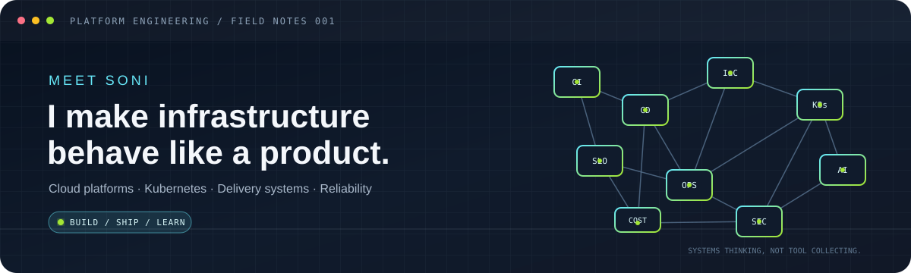
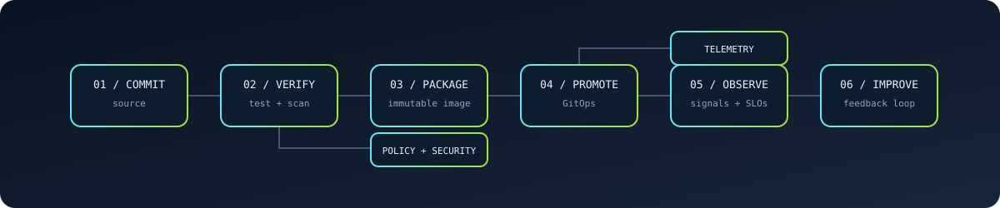

  

  

    
    
    
  

## `01 / THE WORK`

I'm a DevOps / Platform Engineer working where **software delivery meets production reality**.

I like the unglamorous, high-leverage work: removing friction from releases, making infrastructure repeatable, figuring out why a system is failing, and making the next incident less mysterious than the last.

I don't collect tools for the sake of it. I use them to make systems easier to ship, understand, secure, and afford.

## `02 / SIGNAL, NOT NOISE`

<table>
  <tr>
    <td width="33%" valign="top">
       
      <strong>−70% monthly AWS spend</strong> 
      One environment went from roughly $10k to $3k/month after workload and managed-service cost analysis.
    </td>
    <td width="33%" valign="top">
       
      <strong>10+ hours → 3–4 hours</strong> 
      Reduced CI/CD setup effort per service through reusable workflows and shared deployment patterns.
    </td>
    <td width="33%" valign="top">
       
      <strong>Database restored. No data lost.</strong> 
      Worked through a Kubernetes/PostgreSQL storage incident by protecting and recovering the surviving data.
    </td>
  </tr>
</table>

## `03 / HOW I THINK ABOUT DELIVERY`

  

A pipeline is not just a sequence of YAML steps. It's a system of controls and feedback:

- **Commit → verify:** repeatable builds, tests, and security checks.
- **Package → promote:** traceable artifacts, environment boundaries, and GitOps.
- **Observe → improve:** useful telemetry, actionable alerts, and evidence-led incident response.

## `04 / THE TOOLBOX`

  

| SYSTEM | THINGS I BUILD WITH |
|:--|:--|
| **Cloud & compute** | AWS · Azure · GCP · EKS · AKS · GKE |
| **Infrastructure** | Terraform · Helm · Kustomize · Karpenter |
| **Delivery & GitOps** | GitHub Actions · Jenkins · Azure DevOps · Argo CD · Argo Rollouts |
| **Observability** | Prometheus · Grafana · Loki · ELK · PagerDuty |
| **Security** | Trivy · SonarQube · Fortify · IAM/RBAC · secret management |
| **Traffic & data** | Gateway API · Istio · NGINX · PostgreSQL · Redis · Kafka |
| **Automation & AIOps** | Python · Bash · Go · n8n · AWS Bedrock |

## `05 / SELECTED WORK`

### [Kubernetes CI pipeline ↗](https://github.com/Meet-S0ni/kubernetescode)
**Build lane.** Jenkins pipeline for building and packaging a containerized Python application.

`Jenkins` `Docker` `Git`

### [Kubernetes GitOps manifests ↗](https://github.com/Meet-S0ni/kubernetesmanifest)
**Deploy lane.** Kubernetes manifests managed through Argo CD, separating application delivery from the build pipeline.

`Kubernetes` `Argo CD` `GitOps`

### [Azure Kubernetes infrastructure ↗](https://github.com/PredictiveResearchPtyLtd/milana-infra-as-code)
**Infrastructure lane.** Open-source Terraform work covering AKS, ACR, ingress, and Grafana monitoring.

`Azure` `Terraform` `AKS`

### More than happy-path engineering

Some of the most useful work happens when reality disagrees with the diagram:

- **A network path that looked open but wasn't:** traced private-to-public service connectivity to the actual translated source address.
- **A noisy incident becomes a useful signal:** built an event-driven diagnostic workflow that gathers Kubernetes context and produces structured RCA output.
- **A platform grows without every service becoming a snowflake:** standardized reusable delivery patterns across 25+ services and 15+ repositories.

*These are sanitized summaries. Client names, private architecture details, and sensitive incident specifics are intentionally omitted.*

## `06 / OPERATING PRINCIPLES`

  
<strong>What I optimize for</strong>

  - **Boring releases.** A deployment should be repeatable, observable, and reversible.
  - **Evidence before intervention.** Metrics, logs, events, and dependency paths before a blind restart.
  - **Guardrails over heroics.** Good defaults, least privilege, automated checks, and clear ownership.
  - **Cost with context.** Optimize the workload and its actual usage—not just the invoice.
  - **Learning that compounds.** Turn incidents into runbooks, automation, and better system design.

## `07 / FIND ME ELSEWHERE`

  
  
  
  

  Infrastructure is a product. Production is the user.

